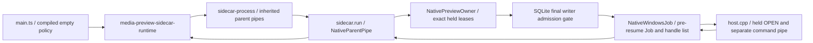

# MLT原生宿主与私有进程适配器源码

当前是SOURCE_ONLY_NOT_ADMITTED。生产main已接入编译期发布策略工厂；策略为空时返回`runtime:null`。没有编译C++、安装
或启动原生进程，未验证ABI、窗口、解码、DLL竞态或时钟。既有23页/五阶段完整
产品范围不变，下面的能力版本1是首个实现子集，不是完整Animatic/导出验收。

## 源码与数据职责

`media_preview_plan_routes.derive_native_preview_plan`从同一精确装配/分镜/批准/
probe真相只读派生，HTTP继续复用此函数。`native_preview_materials`仅为私有
可信调用者准备已选视频原件的哈希快照；再次核对完整计划、最新权利、G5和
实际原件/快照。精确asset/version/SHA不被新head替换，快照位置不进入HTTP或
preload。准备失败只清理自己的随机名字；一旦标记派发，UNKNOWN/超时/Promise
拒绝都不能删除快照，只有owned进程终止证据才能释放。没有新增存储或任务。

`media-preview-native-wire.ts`定义有界私有二进制合同，`media-preview-native-runtime.ts`
把已有supervisor接到owned字节管道。第25批已从实际main/sidecar入口接通源码所有权链：
编译期策略→同源父子管道→sidecar原始句柄所有者→受保护cwd/held材料→同步
准入派发。该链默认拒绝，无实际二进制、WinAPI/ABI、加载或播放验收。

第22/23批的`native/mlt-preview-host/owned_job.cpp`与`SealedLaunch`保留为未编译
的C++所有权源码；第25批实际生产绑定使用Python WinAPI所有者（下节），没有
宣称这些C++包装器已被生产调用。原C++进程创建设计：先创建
kill-on-close/单进程Job，以STARTUPINFOEX在CreateProcess时绑定Job和三个管道，
受限继承/远端低完整性镜像禁止/System32优先，再确认Job归属后ResumeThread。
环境只含Windows系统目录和可信private TEMP/TMP，不继承凭据、用户PATH或插件
配置。失败对象必须由绑定保留；kill_and_wait只在Job ActiveProcesses=0时成功，
绑定还须join管道reader。root exit/signal/EOF/UI终态均不是释放证明。原有
FFmpeg Microsoft签名DLL门槛未修改，新宿主需要单独完整PE/DLL准入，不能借用
开发CLI profile放宽它。

`host.cpp`使用动态MLT C API建立固定profile、playlist、avformat原件和sdl2窗口，
关闭嵌入声音；seek/pause清理buffer并等待native consumer观察到目标帧。回执
仅从补丁专用aivora-consumer-frame-presented填shown_frame，不用JS计时器、canvas或编码后的MP4
冒充实时帧。上游普通frame-show即使无有效image仍可能发出，故本地补丁只在图像读取、texture/render无已报告错误且已请求SDL_RenderPresent后发专用事件；选中片段的test_image也拒绝。这仍不证明GPU scan-out或完整创作质量，也不提供音频硬件输出
时钟，版本1始终返回音频样本/采样率null。[MLT consumer API](https://raw.githubusercontent.com/mltframework/mlt/v7.40.0/src/framework/mlt_consumer.h)

## 封闭加载与准入

只核一个advertised profile_hash是不够的。适配器重算完整规范profile摘要，
同时匹配可信应用allowlist、能力版本、MLT版本、源码补丁、PE闭包和许可/对应
源码收据摘要、全部相对文件/大小/hash与绝对owned文件。HOST/framework、三个
模块和third-party-notices都必需；未知字段/新增能力/网络开启/错模块/文件差异
拒绝。当前无准入profile，源码配置不能开启production runtime。

MLT上游factory会枚举插件目录，held目录不阻止新增子文件，故本批提供明确标注
的LGPL源码补丁`MLT-7.40.0-explicit-repository.patch`：导出revision2标记并允许
可信宿主关闭自动扫描，并在SDL图像/texture/render失败时拒绝发专用呈现事件，随后按已固定原件只注册core/avformat/sdl2三个模块。
宿主先验证标记再factory init，普通未修改framework拒绝。源文件和祖先以
deny-write/delete handles核SHA并持有到退出，显式DLL目录排除用户PATH。
补丁语法已静态解析；对完整官方源码应用、编译和真实Windows加载仍未执行。
[上游repository源码](https://raw.githubusercontent.com/mltframework/mlt/v7.40.0/src/framework/mlt_repository.c)

所有DLL的普通/延迟导入、实际第三方闭包、static CRT/system-only startup、
签名/哈希、目录/DACL/竞态和Unicode路径必须由将来的真实准入验证。源函数中
`OwnedJob.start`的executable/cwd只能由持有验证句柄的可信绑定传入；不能直接
用Node spawn或renderer参数替代该绑定。源码清单不表示该门已通过。

## 私有wire版本1

全部整数是uint32 little-endian。每包前置payload字节数，最大131072；字符串
是uint32 UTF-8字节数+完整UTF-8，最大16384，禁止NUL/无效UTF-8/尾随字段。
协议与媒体会话不会走公共HTTP、WebSocket或preload路径输入。

| 包      | payload顺序                                                                                                                                                                                                                                                         |
| ------- | ------------------------------------------------------------------------------------------------------------------------------------------------------------------------------------------------------------------------------------------------------------------- |
| OPEN    | version=1,type=1,session,generation,open_request,规范identity JSON,ISO expiry,profile hash,framework/modules/data owned路径,runtime文件数及(path/rawSHA/size),canvas宽高,fps分子分母,total_frames,clip数及(path/rawSHA/size/start/end/source_in/source_frame_count) |
| COMMAND | version=1,type=3,递增sequence,generation,kind(status0/play1/pause2/seek3/close4),原command_id,status时空串,frame                                                                                                                                                    |
| STATUS  | version=1,type=2,sequence(OPEN为0),session,generation,open_request,原identity JSON,原expiry,state(READY0/PLAYING1/PAUSED2/CLOSED3/FAILED4),shown_frame(未知0xffffffff)                                                                                              |

一个连接同时只有一个请求；最多1024个wire command，256个原mutation记录，
保留相同正文的已完成/UNKNOWN结果，异正文同ID拒绝。超时/坏回执/未请求回执/
累计stdout超过2MiB/stderr超过64KiB拒绝，owned单次终止；不能重发UNKNOWN。
固定session/open/full identity/generation/expiry及帧范围均核对。lease使用原生
单调时钟守卫，parser/decoder/pipe挂起同样会触发进程结束；不产生模拟帧。
初始私有握手10秒，hard lease最多1小时，现有supervisor默认5分钟不变。

版本1只覆盖既有mapper的一轨同尺寸CFR视频、静音嵌入音频与原生窗口/显示帧。
图片/缩放/转场/多轨声音/音频输出clock/字幕/编码/发布均明确拒绝，没有扩大
DRAFT32视觉/32音频/30分钟/1920或原件大小边界。完整产品需要后续能力版本与
真实证据，不能更改常量或把无音频预览当作完整实时装配。

## 具体依赖与后续动作

机器清单在`config/native-preview-source-plan.json`，每项列名称、版本、来源、
用途、许可状态与下一动作。核心为MLT7.40.0+本地补丁、SDL2 2.32.10、PThreads4W
3.0.0、dlfcn-win32 1.4.2、dirent1.26和GNU libiconv1.18。固定vcpkg registry
`12dcccadfe573d0eaa6c67a968413ded7805d256`用于查询来源，不直接采用其完整默认
依赖或FFmpeg8.1.1。MLT Windows framework实际链接iconv/pthread/dirent，不能
省略其闭包。[MLT framework CMake](https://raw.githubusercontent.com/mltframework/mlt/v7.40.0/src/framework/CMakeLists.txt)

新解码库候选是官方FFmpeg8.1.3源码，目标关闭network/GPL/nonfree/version3、
外部codec/device/encoder/muxer，仅file协议和mov/matroska输入；实际参数和ABI
仍需获准构建后验证。旧8.1.2 Gyan GPL DEVELOPMENT_ONLY CLI及TEST不改、不进入
发行profile。官方说明FFmpeg许可随实际配置与组件改变，源候选不是已完成发行
许可审查。[FFmpeg许可说明](https://ffmpeg.org/legal.html)、[官方源码目录](https://ffmpeg.org/releases/)

宿主/owned Job新源码为本仓Apache-2.0；MLT修改按其LGPL保留原许可和对应源码/
补丁/构建与relink材料。SDL2 Zlib、兼容组件各自MIT/Apache或GNU库许可须取实际
版权/NOTICE全文及传递闭包，不能只凭元数据推断整包许可通过。
[MLT版权政策](https://mltframework.org/docs/copyrightpolicy/)、[SDL2许可](https://raw.githubusercontent.com/libsdl-org/SDL/release-2.32.10/LICENSE.txt)

主进程—私有sidecar—native Job绑定源码已在第25批接入；具体二进制准入与实机验证待完成。后续
获取/安装/构建/运行必须另列MSVC、Windows SDK、CMake、Ninja、vcpkg及每个源码
包的精确官方URL/版本/hash/体积/目录与权限动作，再取得授权；本批不下载这些
包或二进制，不用“缺获批清单”代替已经可以完成的源码工作。

## 第23批：静态被持有PE字节和启动前封存

`media-preview-pe-admission.ts`读取必须来自native持有句柄的原始字节，核对
完整profile文件清单、完整PE收据及规范摘要，解析普通导入、RVA delay和export
forwarder的封闭依赖。x64/PE32+、唯一file-backed RVA、大小/terminator/名称界限
独立核对；bound/VA-delay/CLR、嵌入manifest和命名resource type拒绝。host的
第三方启动依赖和动态CRT拒绝；所有DLL basename唯一，System32/API-set同名
载荷拒绝，module依赖只能在已核验的root/module目录解析。系统集合由可信
Windows发布策略提供，不能从用户manifest或环境扩大。

解析布局依据[Microsoft PE格式](https://learn.microsoft.com/windows/win32/debug/pe-format)。
这不是OS loader等价验证，也不证明动态加载/视频驱动/代码签名/许可；这些须
完整build/source/profile与真实Windows结果。当前没有任一实际二进制被准入。
私有WeakMap证明绑定完整profile；`MltLaunchLease`的pipe factory必须先核对
证明再启动，伪造/clone/换profile拒绝。证明不可序列化保存或当用户批准。

`SealedLaunch`实际Windows源码持有所有启动文件/目录链，hash和handle最终路径
核验在启动前完成；`OwnedJob`移交该对象后不再提供裸路径start。partial start
保持所有权；最后析构不能证明零活动进程时，封存句柄保持到所有者进程退出，
不把close当release receipt。私有绑定必须在zero-active和所有pipe readers join
后销毁native owner再释放Python快照；即便root exit/EOF也不省略这个顺序。
CMake源目标使用静态CRT、禁用manifest和明确UTF-8。protected cwd、实际native
句柄字节读取和main/sidecar绑定仍待接入；当前C++未编译/运行，main runtime:null。

## 第25批：实际生产入口与所有权链

这是源码可追踪的调用关系，当前main策略与sidecar策略均为空，没有“开关”可从
renderer、HTTP、环境或磁盘文件准入。工厂在未准入时返回null；私有管道的
合法prepare实际回UNAVAILABLE，且在资源/快照/WinAPI之前拒绝。现有公共HTTP、
preload和SQLite真相不增加另一条存储或可执行入口。

Python侧复用`external_process_session`的创建时owner+SYSTEM DACL、held cwd、
最小系统环境；完整runtime/source原件/快照及目录链经原文件句柄验证/持有。
主进程PE检查的每块原始字节都从同一持有stream读取，不重新打开可变路径。
独立许可/source/build收据也是held inventory的一件，不以声明替代文件。私有
随机lease归属仅存内存，部分失败和UNKNOWN继续保留原所有者。

OPEN由sidecar从自身精确材料独立重建，与main包逐字节比较，保存并持有只读
opening.bin；在第24批同SQLite最终写门内同步CreateProcess/Job归属/Resume。
子进程STD_INPUT继承此冻结文件句柄；仅后续命令走单独继承control pipe。这
避免先检查后等待JS再发送首个OPEN的空档。host保留旧匿名stdin模式源码。

`native_preview_windows_job`在创建时原子绑定kill-on-close/单进程Job、四个
明确继承句柄和独立MLT缓解策略；不更改旧FFmpeg Microsoft-only门。实际
stdout/stderr/writer/exit observer各保留原线程的DuplicateHandle，取消调用
CancelSynchronousIo；取消成功仍必须join。reader排空后才发root exit，root
exit、Job0或一次cancel均不足以释放。start/stop同锁，待定/部分启动不能释放。
线程句柄关闭失败保留handle；Job查询/进程关闭/reader join不明确均拒绝证明，
sidecar shutdown仍保留工作区锁与材料，main不能从sidecar root退出伪造Job证明。
[取消语义](https://learn.microsoft.com/en-us/windows/win32/api/ioapiset/nf-ioapiset-cancelsynchronousio)、
[继承句柄及Job属性](https://learn.microsoft.com/en-us/windows/win32/api/processthreadsapi/nf-processthreadsapi-updateprocthreadattribute)。

wire generation由OPEN开始；每个mutation只接受上一代+1，status只接受当前代。
每个原waiter核对自身代号，UNKNOWN不倒退、不重发。supervisor只读查询占用与
mutation互斥；未发命令不能推进代号。合法CLOSED回执后同turn退出保留CLOSED，
但同集重新准入仍等待独立的owned stop证明。所有命令/私有请求沿原ID保留。

私有父子JSON行绑定实际spawn PID/父PID和原请求ID，长度/UTF-8/重复字段/未知
字段/单一lease stream owner及事件顺序严格核对。通道出错关闭、待定UNKNOWN，
既不重发也不转移到重启后的另一sidecar。应用退出先等native shutdown再关闭
sidecar管道；不开放公开端口、凭据、模型或付费操作。

受控Kernel/真实Python线程、临时SQLite与真实Python sidecar入口测试均不是
Windows WinAPI或本机native运行。真实PE、全部动态/系统/视频驱动闭包、Unicode、
DACL/TOCTOU、MLT补丁应用、编译安装、窗口/解码/显示帧及父进程退出实測仍待
单独获准的Windows环境；完整23页五阶段和原Word逐页核对仍未完成。
