# 界面验收

日期：2026-10-21。对象是正在运行的 Web 工作台 `http://127.0.0.1:5173/`（生产入口，不是样例数据）。没有发起真实模型调用，也没有合并到 main。预算预留和派发代码没有改。

自动检查是 `apps/studio-web/e2e/layout-audit.mjs`，命令：

```bash
pnpm --filter @aijian/studio-web dev
pnpm --filter @aijian/studio-web audit:ui
```

窗口尺寸按 CSS 像素，对应 Windows 缩放后的可视区域（布局由 CSS 像素决定，`deviceScaleFactor` 与缩放一致）：

| 名称 | CSS 视口 | 对应 |
| --- | --- | --- |
| 1920×1080 | 1920×1080，DPR 1 | 1080p，100% |
| 1536×864 | 1536×864，DPR 1.25 | 1080p，125% |
| 1366×768 | 1366×768，DPR 1 | 常见笔记本，100% |
| 1280×720 | 1280×720，DPR 1.5 | 1080p，150%，也是要求的 720p |
| 1093×614 | 1093×614，DPR 1.25 | 1366×768，125% |
| 911×512 | 911×512，DPR 1.5 | 1366×768，150% |

每个尺寸检查 23 个页面，加上通知对话框、用户菜单、AI 助手栏，以及 AI 服务里的 API 连接和 ChatGPT 两个面板。合计 156 个画面。检查三项：控件中心被别的元素挡住、控件被 `overflow: hidden` 裁切且没有可滚动的祖先、控件自身文字被裁切。已经滚出可滚动区域、但仍能滚回来的内容，不算失败。启动页是整屏封面，盖住后面的导航是这页本身，不把被盖住的导航算作故障。

最终一轮：156 个画面，0 个问题。

Electron 壳没有启动。这个环境里没有 Electron 可执行文件，桌面窗口加载的也是同一套 `studio-web` 页面。下面的结论是 Web 渲染器在上述窗口里的结果。

没有本地工作区，所以依赖已保存作品的抽屉（角色详情、分镜编辑）没有打开。打开过的是启动页、通知、用户菜单、助手栏和两个服务面板。

## 界面审核

第一轮在改布局之前。测量到的问题：

- 1920×1080 到 911×512，AI 服务页的主区域 `scrollHeight` 大于可视高度，但 `overflow` 是 hidden。连接表单、密钥按钮和模型选择在视口外，滚不到。
- 高度不超过 768 的窗口里，左侧导航不滚动。1366×768 上，底部「存储用量尚未接入」盖住「AI 服务」。更矮的窗口里，「素材」「导出」「制作」「审片」被导航容器裁掉。
- 911×512 的设置页，「本地媒体工具 · DRAFT」和标题「用户设置」叠在同一位置（都从 y=100、x=124 开始），标题盖住按钮。
- 720 及更矮的窗口里，设置、用量、声音页同样锁死滚动。

处理：

- 生产工作台的主区域和左侧导航改为可滚动，底部说明不再绝对定位盖住导航项。窄导航的文字改为换行，不再用省略号。
- AI 服务页按内容增高，由页面滚动，不再把表单压进一个不能滚的格子。
- 设置页顶部的媒体工具按钮不再被 flex 压成 0 高度后画到标题上。
- 启动页在矮窗口允许滚动，标题允许换行。首次连接对话框在窄窗口改成单列。

前后截图：

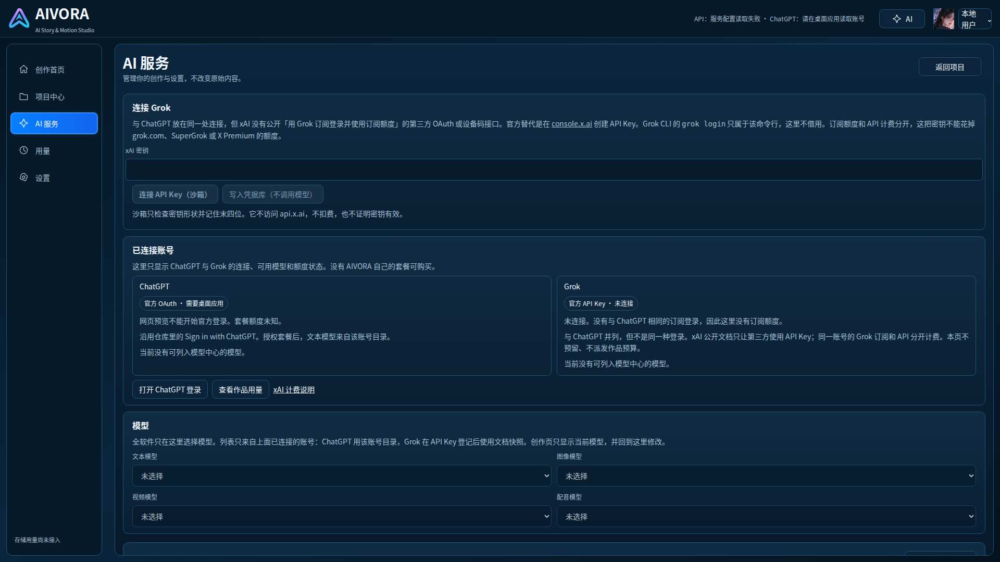

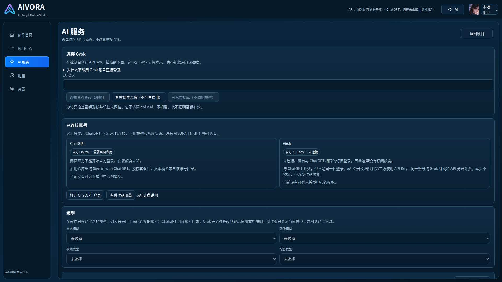

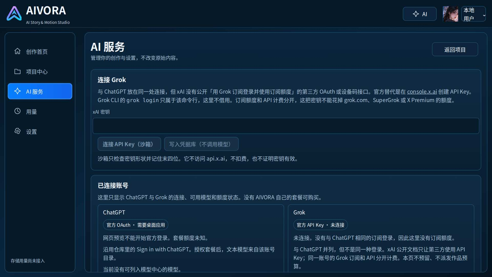

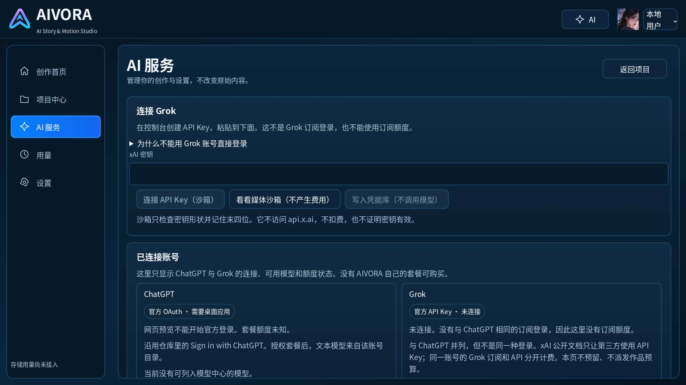

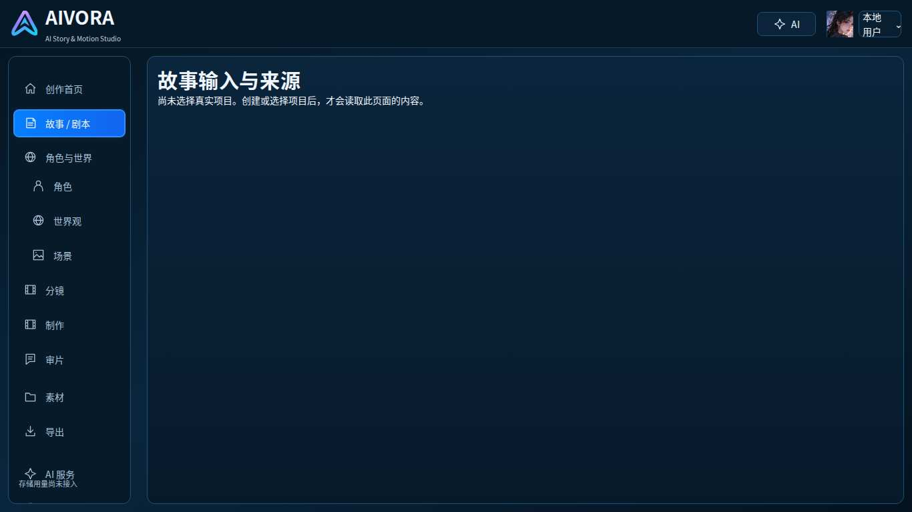

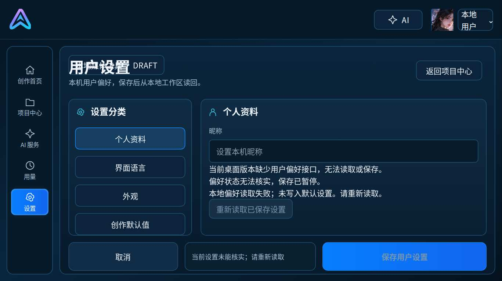

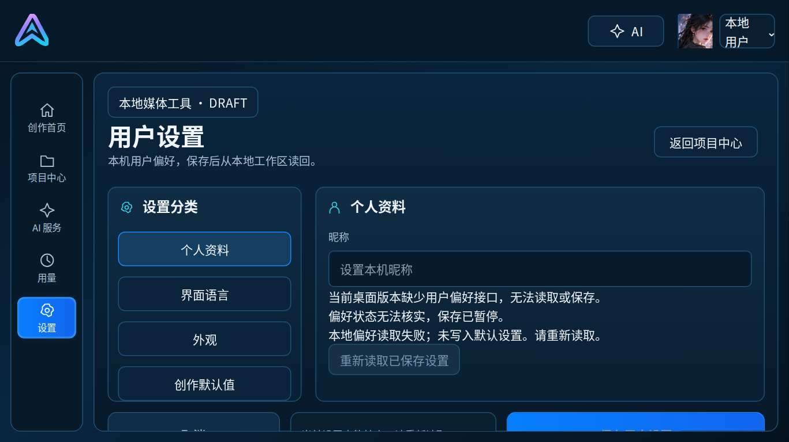


## 两位虚拟用户

### 林可，专业创作者

做过短片，用过可灵、即梦这一类工具。关心三件事：账号是不是官方的、模型是不是自己选的、这一下会不会扣费。

第一轮（改之前，对照当时的页面文字和上面的遮挡）：

- AI 服务页在 1080p 上都滚不到密钥和模型选择。连接这一步是断的。
- Grok 的说明把 OAuth、设备码、`grok login`、SuperGrok 放在密钥框前面，专业用户能看懂，但要点很多次滚动。
- 连上文本模型之后，没有一条短路径去看一次不扣费的演示。
- 新建作品要求「本地工作区」。桌面服务没开时，只能看到一句连接失败，不知道接下来能做什么。
- 预算按钮仍然是禁用的。这是预期：本分支不改预算。

第二轮（改完后，1366×768、1280×720、911×512 都走通）：

1. 进入创作工作台
2. 连接 Grok（API Key）
3. 粘贴一把形状合法的沙箱密钥（这一步是输入，不是点击）
4. 连接 API Key（沙箱）。页面读回「API Key 已登记 · 末四位 0001」，并写明不访问 api.x.ai、不扣费
5. 在模型中心把文本模型选成「Grok 4.7 · xAI 文档目录」
6. 看看媒体沙箱（不产生费用）
7. 沙箱提交

点击 6 次，外加一次粘贴。提交后的状态是 `queued`，原文是「沙箱已排队。没有访问上游，没有预留预算，没有产生费用。」

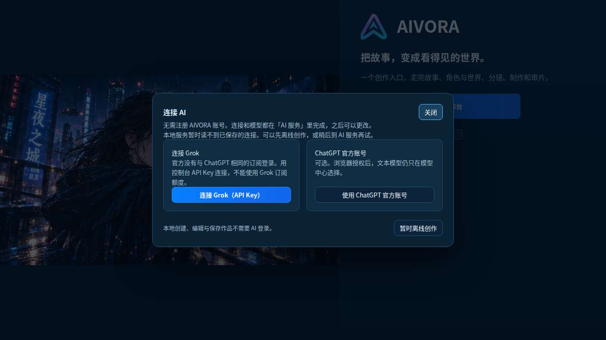


林可仍会不满意的地方，留在文末，没有再改：视频沙箱上的「当前视频模型」仍是「未选择」。文档目录里没有 Grok 视频模型，文本模型不会填到这个格子里。按钮文案改成「看看媒体沙箱」，避免让人以为刚粘贴的密钥会去生成视频。

### 周宁，第一次使用

不做视频，不认识 API Key、工作区、沙箱、派发。

第一轮：

- 首次对话框在桌面服务没连上时写「已有 API 配置暂时无法读取」。周宁还没配置过，这句话像是自己把东西弄坏了。
- 「API Key」「订阅额度」能跳过，但跳过之后首页是「本地工作区暂时无法读取」「占位插画」。新建项目只说先连接工作区。
- 制作页同时写「请先选择真实作品」和一排沙箱按钮。沙箱其实能点，这句话让人以为不能点。
- 矮窗口里导航项被裁掉，找不到「制作」。

第二轮，同样三个窗口：

1. 进入创作工作台
2. 暂时离线创作
3. 试用沙箱创作
4. 沙箱提交

点击 4 次。没有选模型。提交结果和林可一样，是本地排队，不产生费用。对话框的失败提示改成「本地服务暂时读不到已保存的连接。可以先离线创作」。制作页改成「上面的媒体任务是本地演示，不需要作品。真正准备镜头，要先选择作品和分集。」

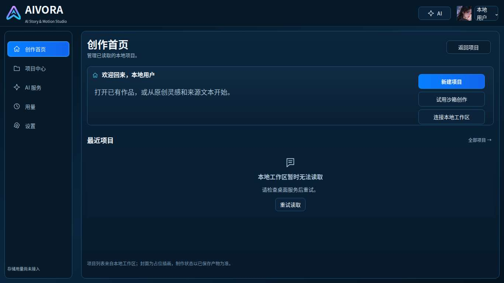

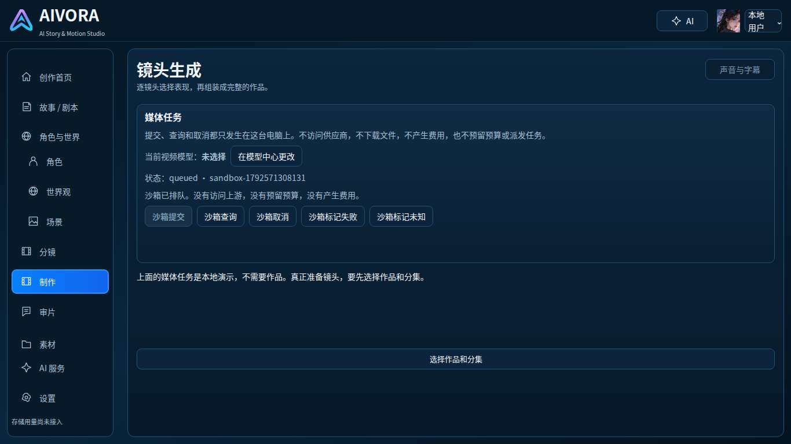

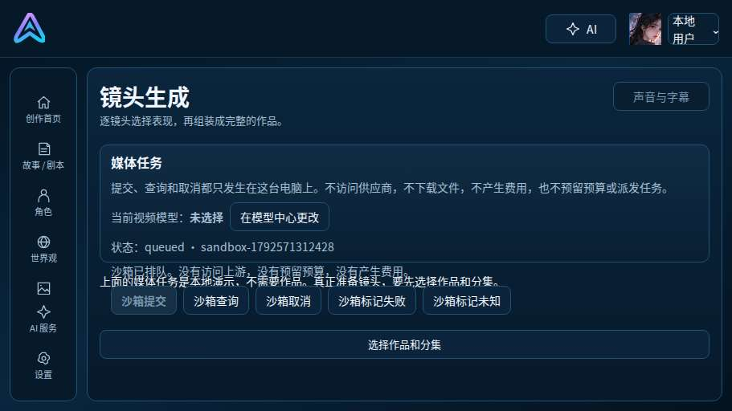

## 主流程步数

| 路径 | 点击 | 还要输入什么 | 到达 |
| --- | --- | --- | --- |
| 林可：Grok 密钥 → 选文本模型 → 一次本地演示 | 6 | 粘贴 API Key | 媒体沙箱状态 `queued`，无上游、无费用 |
| 周宁：离线 → 一次本地演示 | 4 | 无 | 同上 |
| ChatGPT 官方登录 | 2 步后停下 | 无 | 网页预览写明不能开始官方登录，需要桌面应用 |

新建真实作品仍然要先连上本地工作区。这次环境里桌面 API 没有启动，所以没有创建真实项目，也没有走剧本到成片的服务器流程。

## 仍遗留的问题

- 真实作品、剧集和后续制作请求依赖本地桌面服务。服务没开时，首页仍会写「本地工作区暂时无法读取」。
- 预算按钮保持禁用。预算的保存、预留和派发不在这个分支。
- 模型中心选中的 Grok 文本模型不会出现在视频沙箱的「当前视频模型」上。目录里没有对应的视频模型。
- ChatGPT 登录在网页预览里不能开始，需要桌面端的官方 OAuth。
- Electron 窗口没有在本环境跑起来。
- 壳上仍有「存储用量尚未接入」和「DESKTOP CREATOR / V2.0」。
- 依赖已保存作品的编辑抽屉没有在这轮截图里打开。
